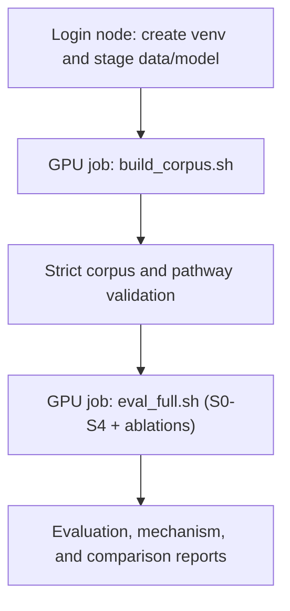

# Running on Narval (Digital Research Alliance of Canada)

This guide covers building the full cultural KG and evaluating systems S0–S4 on
Narval via SLURM. It assumes you have an Alliance account and an allocation (the
`def-<pi>` account string).

Two hard facts shape the workflow:

1. Compute nodes have NO internet. Datasets and model weights must be downloaded
   on the LOGIN node first, then read offline by the GPU job.
2. We use vLLM for batched GPU inference (not Ollama). Ollama remains the local
   dev backend.



## 1. One-time setup (login node)

```bash
# Clone / copy the project into your project or scratch space.
cd $SCRATCH
git clone <your-repo-url> cultural-contextualization-research
cd cultural-contextualization-research

# Load modules (versions may differ; use `module spider` to check).
module load StdEnv/2023 gcc/12.3 python/3.11 arrow/17.0.0 cuda/12.2

# Create an isolated virtualenv (Alliance recommends venv + prebuilt wheels).
python -m venv .venv
source .venv/bin/activate
pip install --no-index --upgrade pip

# Install dependencies from the Alliance wheelhouse where possible.
# Check availability first, e.g.:  avail_wheels vllm
pip install --no-index -r requirements.txt

# vLLM (cluster only). If a wheel is available:
pip install --no-index vllm
# If not available via --no-index, install on the login node with internet:
#   pip install vllm
```

Notes:
- `pyvis` is only used for the optional HTML graph view; if it is not in the
  wheelhouse you can omit it (the corpus build still writes graphml/json/csv).
- `sentence-transformers` is optional; without it, retrieval uses TF-IDF.

## 2. Stage data (and model) for offline use (login node)

```bash
export HF_HOME=$SCRATCH/hf_cache
export VLLM_MODEL=Qwen/Qwen2.5-7B-Instruct   # non-gated default
bash slurm/prep_offline.sh
```

This caches CultureBank + CulturalBench and (if `VLLM_MODEL` is set) the model
weights into `$HF_HOME`. Gated models (e.g. `meta-llama/Llama-3.1-8B-Instruct`)
require `huggingface-cli login` and accepting the license first.

## 3. Verify the allocation in the SLURM scripts

The GPU scripts currently use `--account=def-enaskt_gpu`; `run_tests.sh` uses
`--account=def-enaskt`. Confirm these are still the intended allocations and
change them to the appropriate `def-<pi>` account if the deployment changes.

## 4. Build and validate the retrieval corpus

```bash
export HF_HOME=$SCRATCH/hf_cache
# Full CultureBank run (checkpoint/resume enabled by default):
CORPUS_LIMIT=100000 BATCH_SIZE=32 VLLM_MODEL=Qwen/Qwen2.5-7B-Instruct sbatch slurm/build_corpus.sh

# Smoke test:
CORPUS_LIMIT=50 BATCH_SIZE=16 sbatch slurm/build_corpus.sh
```

Primary construction outputs:

| Artifact | Path |
|---|---|
| Checkpoint state | `data/processed/corpus_build_state.json` |
| Raw triples | `data/processed/corpus_triples.jsonl` |
| Refined triples | `data/processed/corpus_triples_refined.jsonl` |
| Entity map | `data/processed/entity_map.jsonl` |
| Alignments | `data/processed/cross_cultural_alignments.jsonl` |
| Pathways | `data/processed/corpus_pathways.jsonl` |
| Pathway index | `data/processed/pathway_index/` |
| Parquet mirrors | `data/processed/*.parquet` |
| Resolved graph | `data/outputs/resolved_cultural_kg.*` |
| Validation report | `data/outputs/phase2_validation.md` |

The SLURM script runs `scripts/09_validate_phase2.py --strict` after the build.
Do not evaluate a corpus that fails these gates. Also verify that the validation
report, checkpoint, pathway index, and evaluation all belong to the same run;
older checked-in reports span more than one artifact generation.

Optional env vars for `build_corpus.sh`:

- `RESUME=0` — disable checkpoint resume (start fresh)
- `SKIP_ALIGNMENT_VERIFY=1` — embedding-only alignment (faster smoke)

Install optional embedding model for better entity resolution / pathway retrieval:

```bash
pip install sentence-transformers
```

## 5. Evaluate S0–S4 and ablations

```bash
export HF_HOME=$SCRATCH/hf_cache
LIMIT=100000 TOP_K=8 VLLM_MODEL=Qwen/Qwen2.5-7B-Instruct sbatch slurm/eval_full.sh
```

Outputs to `data/outputs/`:
- `culturalbench_summary.md` (accuracy table + McNemar tests)
- `culturalbench_results.json` / `.csv`
- `culturalbench_accuracy.png`
- `mechanism_analysis.md` / `mechanism_h2_completeness.png`
- `before_after_comparison.md`

`eval_full.sh` runs S0–S4 plus the triple-retrieval and no-shared-pivot
ablations. Use `eval_culturalbench.sh` only when you intentionally need a smaller
or custom system set.

## Offline environment variables (set by the GPU job scripts)

```bash
export HF_HOME=$SCRATCH/hf_cache
export HF_DATASETS_OFFLINE=1
export TRANSFORMERS_OFFLINE=1
export HF_HUB_OFFLINE=1
```

If a dataset/model is not found offline, re-run `slurm/prep_offline.sh` on the
login node to cache it.

## Useful SLURM tips

- Interactive GPU debugging: `salloc --account=def-<pi> --gres=gpu:a100:1 --cpus-per-task=6 --mem=48G --time=1:00:00`
- Monitor: `squeue -u $USER`; logs stream to `slurm/logs/`.
- Use `$SLURM_TMPDIR` for fast node-local scratch if you read/write large files.
- Right-size `--time` and `--mem`; A100 (40/80GB) easily holds a 7-8B model at
  `gpu_memory_utilization=0.90`.

## Local development (no cluster)

You can develop and smoke-test everything locally with Ollama:

```bash
ollama serve & ollama pull llama3.1:8b
python scripts/06_build_retrieval_corpus.py --provider ollama --limit 30
python scripts/09_validate_phase2.py --strict
python scripts/07_eval_culturalbench.py --provider ollama --limit 6 \
  --systems S0_no_kg,S3_layered_kg,S4_abstraction_refinement_kg
```

The harness is identical; only the backend (`--provider`) changes.

## Current-result warning

The checked-in full Qwen2.5-7B-Instruct run is a negative result: S0 reaches
52.2% combined accuracy, S3 42.5%, and S4 38.4%. Treat a successful job as an
engineering outcome, not evidence that the research hypothesis passed. Formal
claims also require the human KG-quality, retrieval, stereotype, and fairness
audits defined in `RESEARCH_DESIGN.md`.

Last updated: 2026-09-22.
