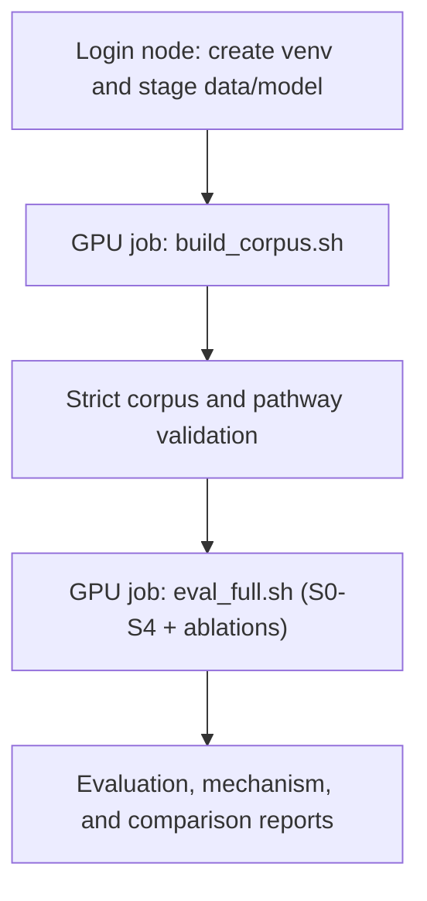

# Running on Narval (Digital Research Alliance of Canada)

This guide covers building the full cultural KG and evaluating systems S0–S4 on
Narval via SLURM. It assumes you have an Alliance account and an allocation (the
`def-<pi>` account string).

Two hard facts shape the workflow:

1. Compute nodes have NO internet. Datasets and model weights must be downloaded
   on the LOGIN node first, then read offline by the GPU job.
2. We use vLLM for batched GPU inference (not Ollama). Ollama remains the local
   dev backend.



## 0. Storage layout (where things live)

Everything lives in one backed-up workspace under `/project`. **Nothing depends
on `$SCRATCH`** (it is purged and was retired on 2026-09-25). Model weights and
dataset caches deliberately stay *outside* the git repo: they are tens of GB,
must never be committed, and would slow every Lustre directory walk (pytest,
`git status`).

```text
/project/def-enaskt/amir01mn/cultural-contextualization-research-cur/   workspace (group quota 1 TB)
├── cultural-contextualization-research-cur/   this git repo
│   ├── .venv/                     Python environment (built from requirements-lock.txt)
│   └── requirements-lock.txt      exact package versions of the Aug 2026 full run
├── hf_cache/                      HF_HOME for every job (set by slurm/env_hf.sh)
│   ├── datasets/                  CultureBank (22,990 rows), CulturalBench Easy/Hard
│   └── hub/                       Qwen/Qwen2.5-7B-Instruct @ a09a354 + dataset repos
└── models/                        older plain copies of Qwen2.5-7B/3B; not used by the code
```

`slurm/env_hf.sh` finds `hf_cache/` relative to the repo, so the workspace
can be moved as a unit. It ignores any `HF_HOME` inherited from the login
shell. Set `CKG_HF_HOME=/path` only to deliberately use another cache.

Every run so far used `Qwen/Qwen2.5-7B-Instruct` at revision
`a09a35458c702b33eeacc393d103063234e8bc28`. `prep_offline_data.py` logs the
revision it downloads; check it matches before comparing new results with old.

## 1. One-time setup (login node)

```bash
cd /project/def-enaskt/amir01mn/cultural-contextualization-research-cur
git clone https://github.com/amir01mn/cultural-contextualization-research-cur.git
cd cultural-contextualization-research-cur

# Load modules exactly as the jobs do (StdEnv/2023, python/3.11, arrow/21.0.0,
# opencv/4.13.0). Source it in the current shell; never pipe it.
source slurm/load_modules.sh && load_login_modules

# Create the venv and install the pinned versions (vLLM 0.23.0, torch 2.11.0, ...).
# scipy, pandas and pyarrow come from the modules, not pip.
python -m venv .venv
.venv/bin/pip install --upgrade pip
.venv/bin/pip install -r requirements-lock.txt
```

`requirements.txt` lists the direct dependencies without versions, for
non-cluster machines. `requirements-lock.txt` is the reproducible cluster
environment. Most wheels come from the Alliance wheelhouse; a few
(`transformers`, `huggingface_hub`, `sentence-transformers`) come from PyPI,
so run the install on a login node, which has internet.

Never copy a `.venv` from another location. Its scripts hardcode the path
where it was created, so `source .venv/bin/activate` would silently switch to
the original environment.

## 2. Stage data and model for offline use (login node)

```bash
VLLM_MODEL=Qwen/Qwen2.5-7B-Instruct bash slurm/prep_offline.sh
```

This downloads CultureBank, CulturalBench, and the model weights into
`<workspace>/hf_cache`. GPU jobs then read them with `HF_*_OFFLINE=1`. Gated
models (e.g. `meta-llama/Llama-3.1-8B-Instruct`) require `huggingface-cli login`
and accepting the license first.

## 3. Verify the allocation in the SLURM scripts

The GPU scripts currently use `--account=def-enaskt_gpu`; `run_tests.sh` uses
`--account=def-enaskt`. Confirm these are still the intended allocations and
change them to the appropriate `def-<pi>` account if the deployment changes.

## 4. Build and validate the retrieval corpus

```bash
# Full CultureBank run (checkpoint/resume enabled by default):
RUN_TAG=<new-tag> CORPUS_LIMIT=100000 BATCH_SIZE=32 VLLM_MODEL=Qwen/Qwen2.5-7B-Instruct sbatch slurm/build_corpus.sh

# Smoke test. Still overwrites data/processed and data/outputs; use a separate
# checkout if those hold artifacts you need. STRICT=0: full-size gates fail at 50.
RUN_TAG=smoke CORPUS_LIMIT=50 BATCH_SIZE=16 STRICT=0 sbatch slurm/build_corpus.sh
```

Primary construction outputs:

| Artifact | Path |
|---|---|
| Checkpoint state | `data/processed/corpus_build_state.json` |
| Raw triples | `data/processed/corpus_triples.jsonl` |
| Refined triples | `data/processed/corpus_triples_refined.jsonl` |
| Entity map | `data/processed/entity_map.jsonl` |
| Alignments | `data/processed/cross_cultural_alignments.jsonl` |
| Pathways | `data/processed/corpus_pathways.jsonl` |
| Pathway index | `data/processed/pathway_index/` |
| Parquet mirrors | `data/processed/*.parquet` |
| Resolved graph | `data/outputs/resolved_cultural_kg.*` |
| Validation report | `data/outputs/phase2_validation.md` |

The SLURM script runs `scripts/validate_corpus.py --strict --state_path "$STATE_PATH"`
after the build, so the gates check the checkpoint this build wrote.
Do not evaluate a corpus that fails these gates. Also verify that the validation
report, checkpoint, pathway index, and evaluation all belong to the same run;
older checked-in reports span more than one artifact generation.

Optional env vars for `build_corpus.sh`:

- `RUN_TAG=<tag>`: use `llm_cache_<tag>/` and `corpus_build_state_<tag>.json`.
  **Always set a new tag for a rebuild.** An old checkpoint marks every record
  complete, so a resumed run would skip extraction entirely. The tag does *not*
  rename the triple, pathway, or report files, so copy `data/` aside before
  rebuilding in a checkout whose artifacts you need (see
  [`RUN_HISTORY.md`](RUN_HISTORY.md) §2).
- `RESUME=0`: disable checkpoint resume and start fresh.
- `SKIP_ALIGNMENT_VERIFY=1`: embedding-only alignment (faster smoke).
- `STRICT=0`: report gate failures without failing the job.
- `GATE_MIN_PATHWAYS`, `GATE_MIN_EXTRACTION_SUCCESS`, `GATE_MIN_CRITIQUE_SUCCESS`,
  `GATE_MIN_L3_SHARE`, `GATE_MIN_FULL_PATHWAYS`, `GATE_MIN_SHARED_PIVOT`: gate
  thresholds. The defaults are sized for the full corpus; lower them for pilots.

Install optional embedding model for better entity resolution / pathway retrieval:

```bash
pip install sentence-transformers
```

## 5. Evaluate S0–S4 and ablations

```bash
LIMIT=100000 TOP_K=8 VLLM_MODEL=Qwen/Qwen2.5-7B-Instruct sbatch slurm/eval_full.sh
```

Outputs to `data/outputs/`:
- `culturalbench_summary.md` (accuracy table + McNemar tests)
- `culturalbench_results.json` / `.csv`
- `culturalbench_accuracy.png`
- `mechanism_analysis.md` / `mechanism_h2_completeness.png`
- `before_after_comparison.md`

`eval_full.sh` runs S0–S4 plus the triple-retrieval and no-shared-pivot
ablations. Use `eval_culturalbench.sh` only when you intentionally need a smaller
or custom system set.

## Offline environment variables (set by the GPU job scripts)

`source slurm/env_hf.sh && setup_hf_offline` sets all of these:

```bash
export HF_HOME=<workspace>/hf_cache   # resolved from the repo location
export HF_DATASETS_OFFLINE=1
export TRANSFORMERS_OFFLINE=1
export HF_HUB_OFFLINE=1
```

If a dataset/model is not found offline, re-run `slurm/prep_offline.sh` on the
login node to cache it.

## Useful SLURM tips

- Interactive GPU debugging: `salloc --account=def-<pi> --gres=gpu:a100:1 --cpus-per-task=6 --mem=48G --time=1:00:00`
- Monitor: `squeue -u $USER`; logs stream to `slurm/logs/`.
- Use `$SLURM_TMPDIR` for fast node-local scratch if you read/write large files.
- Right-size `--time` and `--mem`; A100 (40/80GB) easily holds a 7-8B model at
  `gpu_memory_utilization=0.90`.

## Running the tests

```bash
source slurm/load_modules.sh && load_login_modules   # venv needs scipy/pandas/pyarrow from modules
source slurm/env_hf.sh && setup_hf_offline
export EMBEDDING_BACKEND=tfidf                        # MiniLM from Lustre can take ~10 minutes
.venv/bin/python -m pytest -q -p no:cacheprovider
```

`bash slurm/run_tests.sh` wraps these steps. If the login node's Lustre client
stalls, `sbatch slurm/run_tests.sh` runs the same thing on a CPU compute node.

## Overnight watchers

`slurm/watchers/watch_*_run.sh` are nohup babysitters from the July runs. They
resubmit `build_corpus.sh` after timeouts until the checkpoint is complete, then
submit evaluation. Their limits (`CORPUS_LIMIT`, `EVAL_LIMIT`) are hardcoded for
those runs, so review them before reuse. Their logs go to `slurm/watch/`, which
is git-ignored.

## Local development (no cluster)

You can develop and smoke-test everything locally with Ollama:

```bash
ollama serve & ollama pull llama3.1:8b
python scripts/build_corpus.py --provider ollama --limit 30
python scripts/validate_corpus.py      # report only; full-corpus gates fail at 30 records
python scripts/eval_culturalbench.py --provider ollama --limit 6 \
  --systems S0_no_kg,S3_layered_kg,S4_abstraction_refinement_kg
```

The harness is identical; only the backend (`--provider`) changes.

## Current-result warning

The checked-in full Qwen2.5-7B-Instruct run is a negative result: S0 reaches
52.2% combined accuracy, S3 42.5%, and S4 38.4%. Treat a successful job as an
engineering outcome, not evidence that the research hypothesis passed. Formal
claims also require the human KG-quality, retrieval, stereotype, and fairness
audits defined in `RESEARCH_DESIGN.md`.

Last updated: 2026-09-25.
