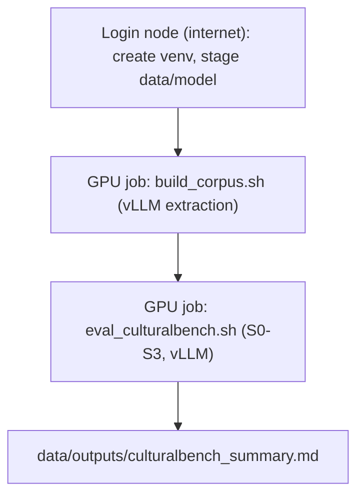

# Running on Narval (Digital Research Alliance of Canada)

This guide covers running the CulturalBench evaluation harness (Phase 1, systems
S0-S3) on Narval via SLURM. It assumes you have an Alliance account and an
allocation (the `def-<pi>` account string).

Two hard facts shape the workflow:

1. Compute nodes have NO internet. Datasets and model weights must be downloaded
   on the LOGIN node first, then read offline by the GPU job.
2. We use vLLM for batched GPU inference (not Ollama). Ollama remains the local
   dev backend.



## 1. One-time setup (login node)

```bash
# Clone / copy the project into your project or scratch space.
cd $SCRATCH
git clone <your-repo-url> cultural-kg-mvp   # or rsync it over
cd cultural-kg-mvp

# Load modules (versions may differ; use `module spider` to check).
module load StdEnv/2023 gcc/12.3 python/3.11 arrow/17.0.0 cuda/12.2

# Create an isolated virtualenv (Alliance recommends venv + prebuilt wheels).
python -m venv .venv
source .venv/bin/activate
pip install --no-index --upgrade pip

# Install dependencies from the Alliance wheelhouse where possible.
# Check availability first, e.g.:  avail_wheels vllm
pip install --no-index -r requirements.txt

# vLLM (cluster only). If a wheel is available:
pip install --no-index vllm
# If not available via --no-index, install on the login node with internet:
#   pip install vllm
```

Notes:
- `pyvis` is only used for the optional HTML graph view; if it is not in the
  wheelhouse you can omit it (the corpus build still writes graphml/json/csv).
- `sentence-transformers` is optional; without it, retrieval uses TF-IDF.

## 2. Stage data (and model) for offline use (login node)

```bash
export HF_HOME=$SCRATCH/hf_cache
export VLLM_MODEL=Qwen/Qwen2.5-7B-Instruct   # non-gated default
bash slurm/prep_offline.sh
```

This caches CultureBank + CulturalBench and (if `VLLM_MODEL` is set) the model
weights into `$HF_HOME`. Gated models (e.g. `meta-llama/Llama-3.1-8B-Instruct`)
require `huggingface-cli login` and accepting the license first.

## 3. Set your allocation in the SLURM scripts

Edit the `--account=def-CHANGEME` line in `slurm/build_corpus.sh` and
`slurm/eval_culturalbench.sh` to your `def-<pi>` allocation.

## 4. Build the retrieval corpus (GPU job)

```bash
export HF_HOME=$SCRATCH/hf_cache
CORPUS_LIMIT=2000 VLLM_MODEL=Qwen/Qwen2.5-7B-Instruct sbatch slurm/build_corpus.sh
```

Outputs to `data/processed/`: `corpus_passages.jsonl`, `corpus_triples.jsonl`,
and `data/outputs/corpus_cultural_kg.*`.

## 5. Evaluate S0-S3 on CulturalBench (GPU job)

```bash
export HF_HOME=$SCRATCH/hf_cache
LIMIT=250 TOP_K=8 VLLM_MODEL=Qwen/Qwen2.5-7B-Instruct sbatch slurm/eval_culturalbench.sh
```

Outputs to `data/outputs/`:
- `culturalbench_summary.md` (accuracy table + McNemar tests)
- `culturalbench_results.json` / `.csv`
- `culturalbench_accuracy.png`

## Offline environment variables (set by the GPU job scripts)

```bash
export HF_HOME=$SCRATCH/hf_cache
export HF_DATASETS_OFFLINE=1
export TRANSFORMERS_OFFLINE=1
export HF_HUB_OFFLINE=1
```

If a dataset/model is not found offline, re-run `slurm/prep_offline.sh` on the
login node to cache it.

## Useful SLURM tips

- Interactive GPU debugging: `salloc --account=def-<pi> --gres=gpu:a100:1 --cpus-per-task=6 --mem=48G --time=1:00:00`
- Monitor: `squeue -u $USER`; logs stream to `slurm/logs/`.
- Use `$SLURM_TMPDIR` for fast node-local scratch if you read/write large files.
- Right-size `--time` and `--mem`; A100 (40/80GB) easily holds a 7-8B model at
  `gpu_memory_utilization=0.90`.

## Local development (no cluster)

You can develop and smoke-test everything locally with Ollama:

```bash
ollama serve & ollama pull llama3.1:8b
python scripts/06_build_retrieval_corpus.py --provider ollama --limit 30
python scripts/07_eval_culturalbench.py --provider ollama --limit 6
```

The harness is identical; only the backend (`--provider`) changes.
